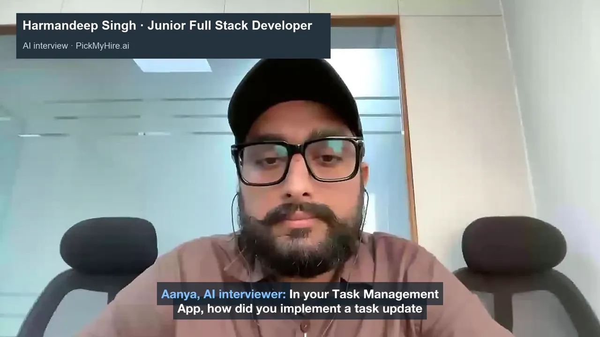

<p align="center">
  <a href="https://pickmyhire.ai"></a>
</p>

<h3 align="center">Interview every candidate. Review only the evidence.</h3>

<p align="center">
  AI video interviews and every hiring round in one place, with evidence you can verify.<br>
  A product of <a href="https://deligence.com"><strong>Deligence Technologies</strong></a>.
</p>

<p align="center">
  <a href="https://pickmyhire.ai"><strong>Website</strong></a> ·
  <a href="https://pickmyhire.ai/demo"><strong>Watch the demo</strong></a> ·
  <a href="https://pickmyhire.ai/signup"><strong>Start a free trial</strong></a> ·
  <a href="https://pickmyhire.ai/login"><strong>Sign in</strong></a>
</p>

---

## What is PickMyHire.ai?

PickMyHire.ai helps hiring teams interview more candidates in less time, without lowering the bar.

An AI interviewer runs a personalized voice and video interview with every candidate, whenever it suits them. Your team then gets a structured report where **every assessment links to the exact moment in the recording and transcript**. Human interview rounds, scorecards and decisions sit in the same place, from the first application to the shortlist.

**The AI never makes hiring decisions.** It conducts interviews and organizes the evidence; your team decides every round.

<p align="center">
  <a href="https://pickmyhire.ai/demo"></a><br>
  <sub><a href="https://pickmyhire.ai/demo">Watch the 4-minute demo</a> · or the <a href="https://pickmyhire.ai/demo#walkthrough">full 11-minute product walkthrough</a></sub>
</p>

## How it works

1. **Create a job.** Paste the description; AI extracts the skills, experience and responsibilities. Set up every interview round for the role, AI or human, in the order you want.
2. **Share the apply link.** Candidates apply with their resume and answer your questions (expected CTC, notice period, joining date and your own). AI checks each resume against the requirements, and the answers are checked against your budget and limits.
3. **Invite to an AI interview.** One click, or a bulk invite. Each candidate gets a personal link and interviews from the browser, with nothing to install.
4. **Review the evidence.** A structured report with strengths and areas to explore, each linked to the moment in the recording.
5. **Run the next rounds.** Schedule interviews with your panel; each interviewer fills in a scorecard.
6. **Shortlist.** Once a candidate clears every round, one overall result brings it all together.

## Features

### Applications and screening
- **Public apply link** per job, for LinkedIn, job boards or your careers page.
- **AI resume screening** against the job's requirements, with quoted evidence. Match tags are capped by evidence, and nobody is auto-rejected.
- **Application questions:** Expected and current CTC, notice period, joining date, location, relocation, work mode, plus your own questions in seven answer formats. Switch each on or off and mark it required, per job.
- **Hiring limits and fit check:** set an internal budget, maximum notice period and other limits. Every candidate is checked against them automatically (Fits limits · Check · Outside limits), so HR only calls about the exceptions.
- **Filters and bulk invite:** find candidates who match both skills and limits, and invite them in one go.

### The AI interview
- **Personalized questions** from the job and each candidate's resume, within the structure your team sets in **interview templates** (sections, timing, question counts, follow-up limits, evaluation criteria, interviewer instructions).
- **Adaptive follow-ups** when an answer leaves a real gap; replies in 2–4 seconds and never cuts off a thinking pause.
- **Candidate-friendly:** runs in the browser, with captions, the option to type instead of speaking, and automatic resume after a dropped connection.
- **Identity check (optional, per job):** a photo at the setup check, then face checks during the interview that flag a different face, a second person or no one in view. Runs on the candidate's device, with consent; flags are for review only.

### Reports and decisions
- **Evidence-backed reports:** section-by-section assessments with an optional 1–5 score; click any evidence and the video jumps to that moment.
- **Compare candidates** for the same job, side by side.
- **Human interview rounds** with calendar invites and your Zoom, Meet or Teams link, and a **scorecard** for each interviewer.
- **Round decisions** (Qualified, Not qualified, On hold), recording who decided and when.
- **Overall result:** once every round is cleared, one summary of rounds, interviewer scores and key evidence, to support the shortlist.
- **HR details and notes** for each candidate (CTC, notice period, joining date and free-form notes), shared across every page they appear on.

### For your team
- **Roles:** Owner, Admin, Recruiter, Interviewer and Viewer, each seeing only what they should.
- **Your brand:** company logo and colour on candidate pages and emails; branded invitations with calendar files.
- **Dashboard and notifications** for applications, completed interviews and ready reports.
- **Downloads:** transcripts, candidate video and interviewer voice.
- **Help and support** built into the app.

## Trust, privacy and security

- **Humans decide.** No AI output ever makes a hire or reject decision.
- **Fair by design.** Only job-relevant evidence is assessed. No inference from age, gender, accent, appearance or emotion; salary and other HR details are never shown to the AI.
- **Consent first.** Candidates see a plain-language notice and give recorded, timestamped consent before anything starts.
- **Company data isolated** at the database level, with permission checks on every request.
- **Private by default.** Resumes and recordings are stored privately and open only through short-lived links.
- **Full audit trail** of report views, recording access, decisions and changes.
- **Retention controls:** delete recordings automatically after a set time, and delete any candidate's data on request.
- **Website analytics only with consent,** and only on public pages, never on interview links or inside the app.

## Architecture at a glance

```
   Recruiters & hiring team                    Candidates
   (any modern browser)                        (browser: camera + microphone)
            │                                          │
            ▼                                          ▼
   ┌──────────────────────────────────────────────────────────────────┐
   │                      PickMyHire.ai platform                       │
   │                                                                   │
   │   Web app ·  Interview engine (rules, timing, follow-up limits)  │
   │   AI services: job parsing, resume screening, question planning, │
   │   answer analysis, evaluation, reports, overall result            │
   │   Roles & permissions · Audit log · Email (invites, reminders)    │
   └───────────┬───────────────────────┬──────────────────────┬───────┘
               ▼                       ▼                      ▼
     Database & private        AI models (OpenAI):     Email delivery
     file storage              realtime voice,         (Resend)
     (Supabase, isolated       transcription,
     per company)              language models
```

- **The interview engine is in charge, not the AI.** The platform decides each question, enforces time and follow-up limits, and keeps the interview on track; the AI supplies wording and analysis within those rules.
- **Live voice** connects the candidate's browser directly to the voice model with a short-lived key, so the platform's AI credentials never leave the server.
- **Recordings and resumes** are kept in private storage, separated by company.
- **Hosted** on Render (application) and Supabase (database and storage).

## Links

| | |
|---|---|
| Website | https://pickmyhire.ai |
| Product demo | https://pickmyhire.ai/demo |
| Start a free trial | https://pickmyhire.ai/signup |
| Sign in | https://pickmyhire.ai/login |
| Cookie policy | https://pickmyhire.ai/cookies |
| Developer guide | [docs/DEVELOPMENT.md](docs/DEVELOPMENT.md) |

## About

**PickMyHire.ai** is built and owned by **[Deligence Technologies](https://deligence.com)**, a technology company focused on practical AI.

© 2026 Deligence Technologies. All rights reserved. PickMyHire.ai and its logo are the property of Deligence Technologies. This repository is proprietary; no part of it may be copied, distributed or used without written permission.
