<p align="center">
  <a href="https://pickmyhire.ai"></a>
</p>

<h1 align="center">Product guide</h1>

<p align="center">
  How to set up PickMyHire.ai and use every feature, from the first job to the shortlist.<br>
  <a href="https://pickmyhire.ai"><strong>Website</strong></a> ·
  <a href="https://pickmyhire.ai/demo"><strong>Watch the demo</strong></a> ·
  <a href="https://pickmyhire.ai/signup"><strong>Start a free trial</strong></a> ·
  <a href="../README.md"><strong>Product overview</strong></a>
</p>

> Screenshots use a sample company (**Northwind Talent**) and sample candidates. Names, emails and answers are made up.

---

## Contents

1. [Before you start](#1-before-you-start)
2. [Create your account](#2-create-your-account)
3. [Set up your company](#3-set-up-your-company)
4. [Interview templates](#4-interview-templates)
5. [Create a job](#5-create-a-job)
6. [Receive applications](#6-receive-applications)
7. [Invite candidates to an AI interview](#7-invite-candidates-to-an-ai-interview)
8. [What the candidate sees](#8-what-the-candidate-sees)
9. [Review an AI interview](#9-review-an-ai-interview)
10. [Human interview rounds](#10-human-interview-rounds)
11. [The candidate page and the shortlist](#11-the-candidate-page-and-the-shortlist)
12. [Help and support](#12-help-and-support)
13. [Good to know](#13-good-to-know)
14. [Quick-start checklist](#14-quick-start-checklist)

Appendix: [Platform admin](#appendix-platform-admin) (PickMyHire.ai team only)

---

## 1. Before you start

**What you need**

- A **work email** for your company. Free email addresses (Gmail, Yahoo and similar) can't start a free trial; ask us for an access code instead.
- A recent **Chrome, Edge, Firefox or Safari** on a computer. PickMyHire.ai runs entirely in the browser, with nothing to install.

**What your candidates need**

- A computer with a **camera and microphone**, a recent browser and a quiet place. They don't need an account; each candidate gets a personal link.

**How hiring flows through PickMyHire.ai**

```
Job ─► Apply link ─► Applications (AI screening + fit check)
                         │
                         ▼
             AI interview ─► Report ─► Round decision
                                              │
                                              ▼
             Human rounds (scorecards) ─► Round decisions
                                              │
                                              ▼
                     Overall result ─► Shortlist / Hire / Reject
```

The AI never decides. It interviews and organizes the evidence; your team makes every decision.

**Roles**

| Role | What they can do |
|---|---|
| **Owner** | Everything, including company settings and the team. One per company. |
| **Admin** | Everything except owner-only company settings: team, jobs, candidates, templates, reports, privacy, branding, usage and audit log. |
| **Recruiter** | Jobs, candidates, templates, invitations, reports and recordings, round decisions and scorecards. |
| **Interviewer** | Sees interviews, reports and recordings, and fills in scorecards for interviews they're on the panel for. |
| **Viewer** | Read-only access to interviews and reports. |

HR details, salary answers and notes are visible only to people who can manage candidates (Owner, Admin, Recruiter).

---

## 2. Create your account

### Start a free trial

Go to **[pickmyhire.ai/signup](https://pickmyhire.ai/signup)** and enter your name, work email, company name and a password (at least 10 characters). The trial includes free AI interviews for 14 days, with no credit card.

If our team gave you an **access code**, choose **Have an access code? Use it here**.

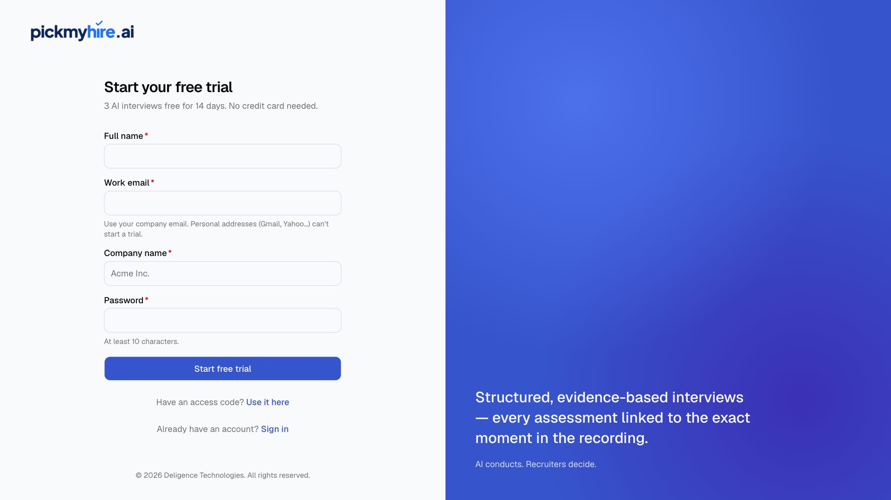

### Sign in

Sign in at **[pickmyhire.ai/login](https://pickmyhire.ai/login)**. Use **Forgot password?** to get a reset link by email, or **Request access** to contact our team.

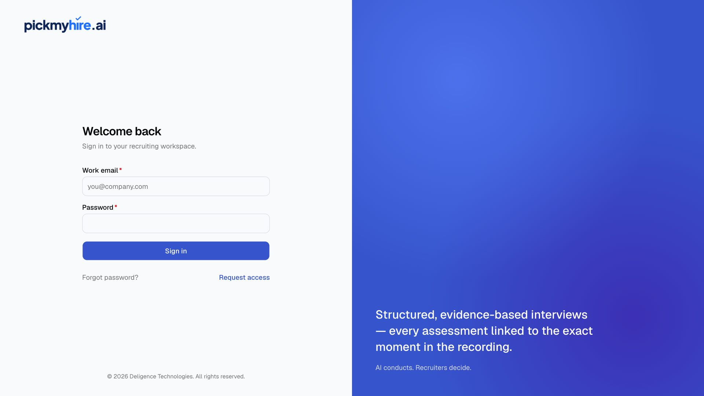

### Dashboard

After signing in you land on the **Dashboard**:

- totals for active jobs, candidates, and interviews invited, started and completed;
- **Recent interviews** with their status;
- **Jobs needing attention**, such as new applications to review or jobs with no candidates yet.

Use **New job** or **Add candidate** in the top right to get going. If you have a promo code, choose **Have a promo code?** next to them. The bell icon shows notifications such as new applications and ready reports.

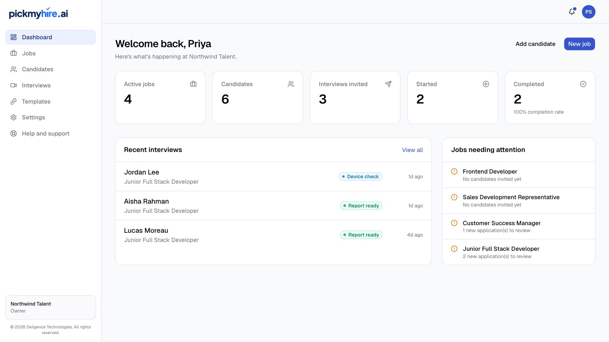

---

## 3. Set up your company

Open **Settings** in the left menu. Do this once before inviting candidates.

### Profile

Your name and password.

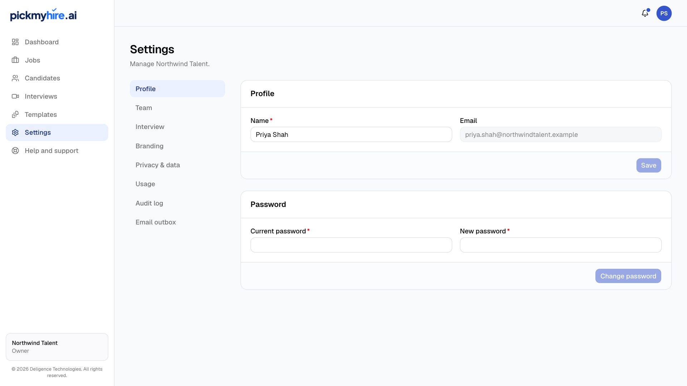

### Team

Choose **Invite member**, enter their email and pick a role. They get an email invitation, and pending invitations can be revoked. You can change a member's role or remove them at any time.

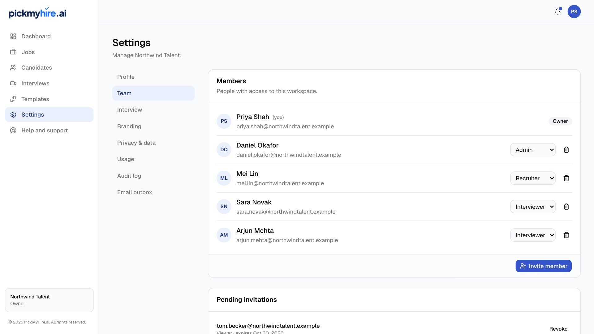

### Branding

Upload your **company logo**, preview it on light and dark backgrounds, and pick a **brand colour**. Candidates see them on your apply pages, interview pages and emails, instead of PickMyHire.ai branding. Text colour is chosen automatically so buttons stay readable.

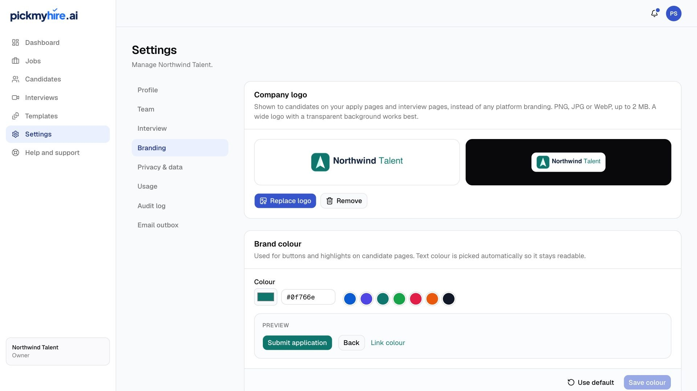

### Interview settings

- **Company name** and the **AI interviewer's name**, as candidates see them (for example "Aanya").
- **Invitation link validity**: how many days an interview link stays open.
- **Show 1–5 section scores**: an optional score next to each section's assessment. Scores summarize evidence; they're never hire or reject decisions.
- **Email recruiters when an interview completes**.

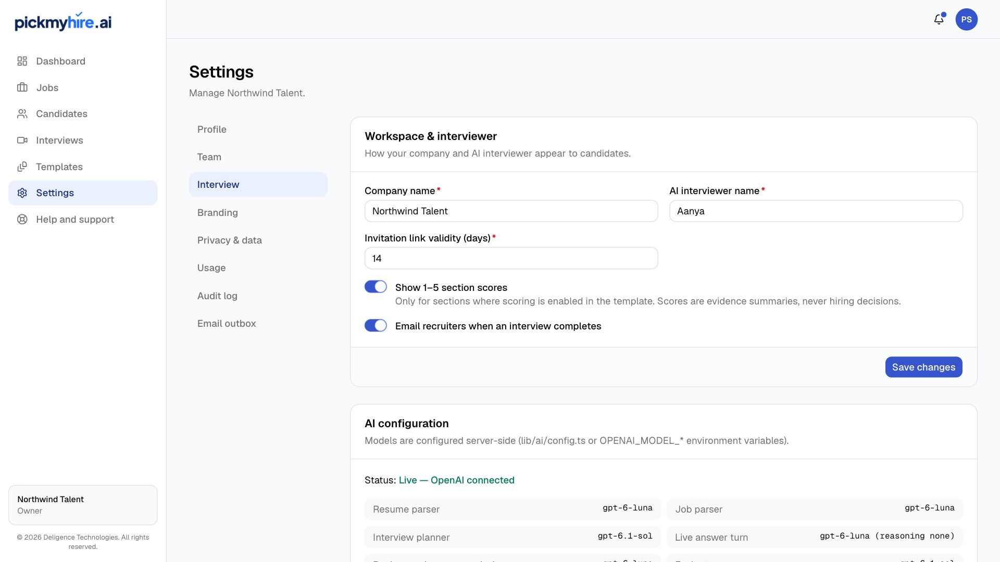

### Privacy and data

- **Data retention**: delete recordings and transcripts automatically after 30, 90 or 180 days, 1 year, a custom period, or keep them indefinitely. Reports and evaluations are kept.
- **Run retention now** applies the policy straight away; every deletion is logged.
- **Deletion requests**: to delete everything about a candidate, open the candidate and choose **Delete**. To delete only a recording, transcript or report, use the actions menu on the interview.

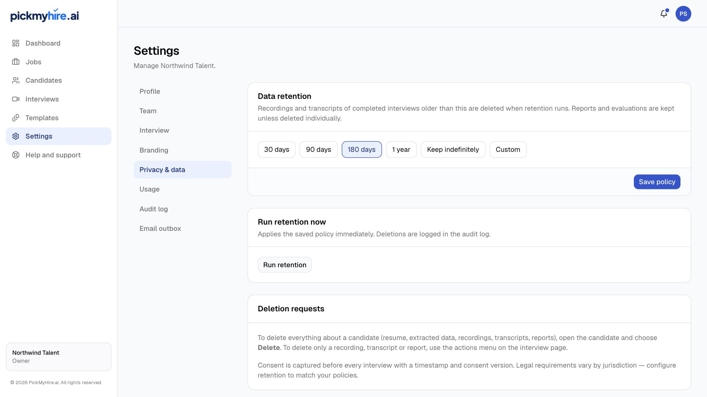

### Usage

How many free interviews you've used and have left, plus interviews and interview minutes over the last 30 days. An interview counts once the candidate completes it; links sent but not finished only hold a slot.

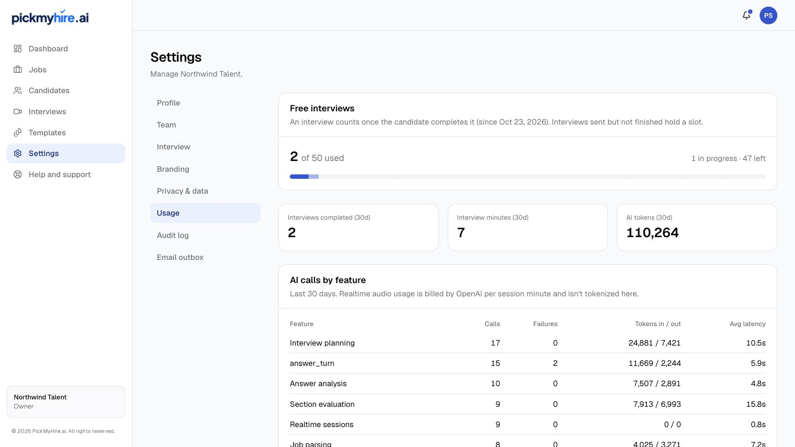

### Promo codes

Got a promo code from us? Owners and Admins can apply it in two places:

- **Settings → Usage → Promo code**: type the code and choose **Apply**;
- the **Have a promo code?** button at the top of the **Dashboard** (also shown when you run out of free interviews).

A code adds **free interviews**, **extra free-trial days**, or both, and your usage updates straight away. Each code can be used once per company. Trial days apply only to companies on a free trial, and restart a trial that has ended. If a code is wrong, switched off, expired or fully used, you'll see "This code isn't valid or has expired."

### Audit log

Every sign-in, decision, report view, recording access and data change, with who did it and when.

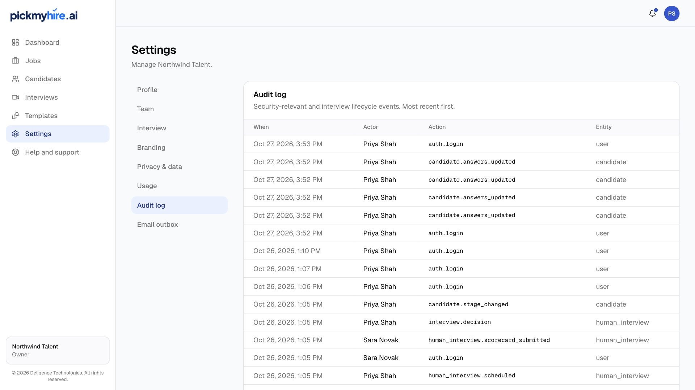

---

## 4. Interview templates

**Templates** decide the shape of an AI interview: which sections it has, how long each takes and how many questions and follow-ups it may ask. The actual questions are written for each candidate, from the job and their resume, within these limits.

Open **Templates** to see your templates. Ready-made ones are included (for example a 5-minute quick screen and a full technical interview). Choose **New template** to create your own.

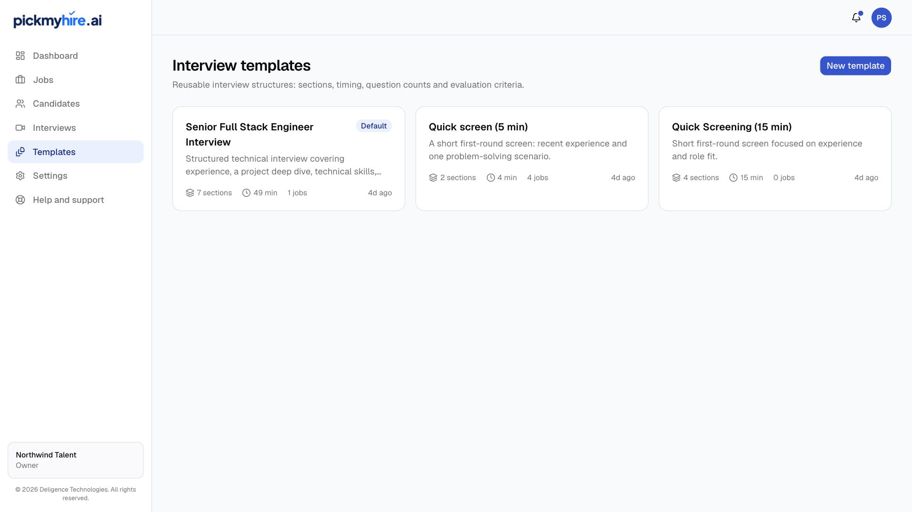

In the template editor you can:

- give the template a **name** and **description**;
- **add, remove, reorder and switch sections on or off** (for example Introduction, Experience, Role fit, Candidate questions);
- set each section's **duration**, **minimum and maximum questions** and **follow-ups per question**;
- open a section to write its **objective**, **evaluation criteria** and **interviewer instructions**.

The total length is shown at the top. Changes apply to new interviews only; interviews already sent keep the structure they started with.

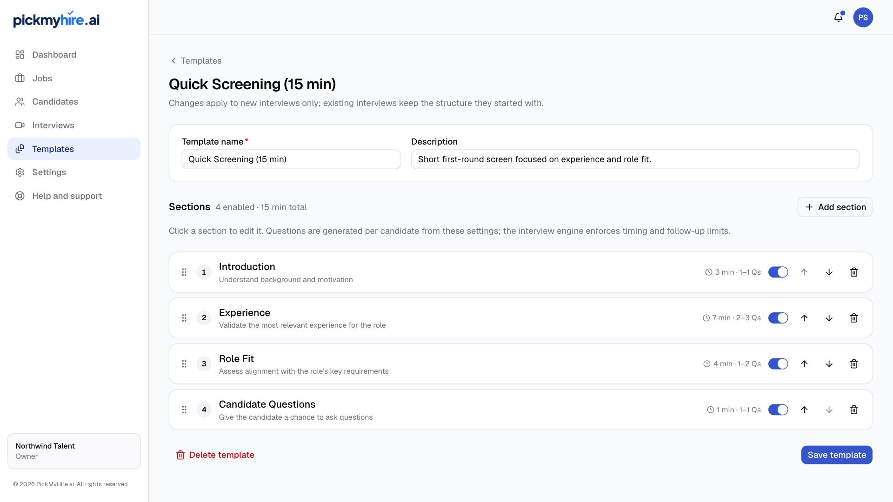

---

## 5. Create a job

Open **Jobs** to see every role, with filters by status and a search box. Choose **New job** to create one.

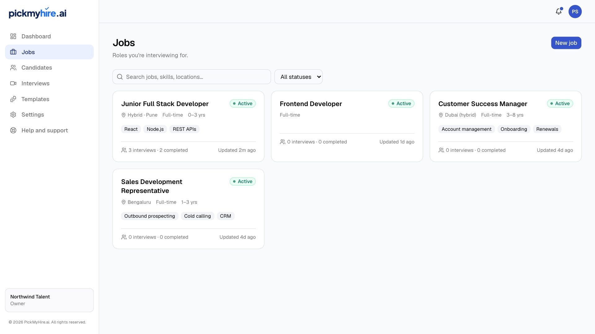

### Basics and description

Enter the **job title**, location, employment type and experience range, then **paste the full job description**. AI extracts the required and preferred skills and key responsibilities; you can edit them as tags. They're used to screen resumes and to personalize every interview.

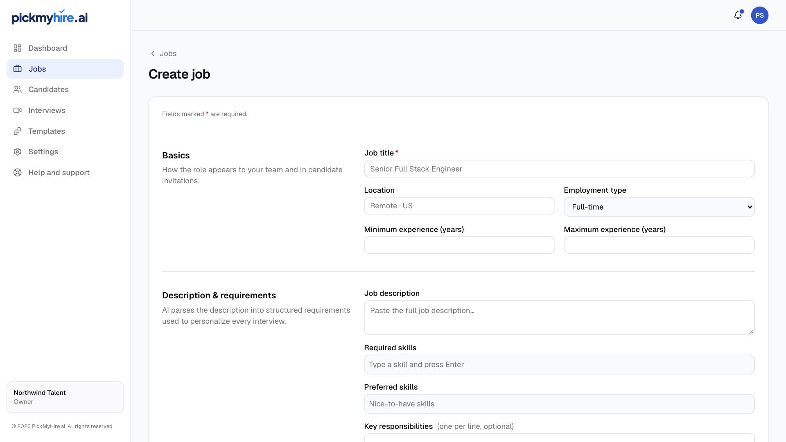

### The job page

Each job has one page with everything about it:

- **Applications** from the public apply link, with AI screening and the fit check (see [section 6](#6-receive-applications));
- **Candidates** in the hiring pipeline: In progress, Shortlisted, Hired, Rejected;
- **AI interviews**, with **Compare** and **Invite candidate**;
- **Public application link**: switch it on and share the link;
- **Parsed requirements** and the job description;
- **Pause**, **Edit** and more in the top right.

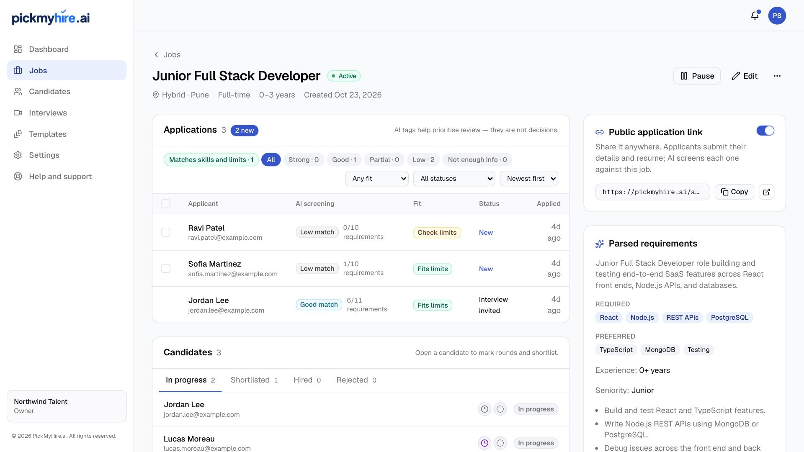

### Interview rounds

Under **Interview rounds**, choose **Edit rounds** to set up every round for the role, in order, for example:

1. **Screening**: an AI interview using a template;
2. **Technical interview**: a human interview with your panel, where you list what to assess (system design, code quality and so on);
3. **Manager round** or any other human or AI round you need.

Each round shows how many candidates completed it and were invited.

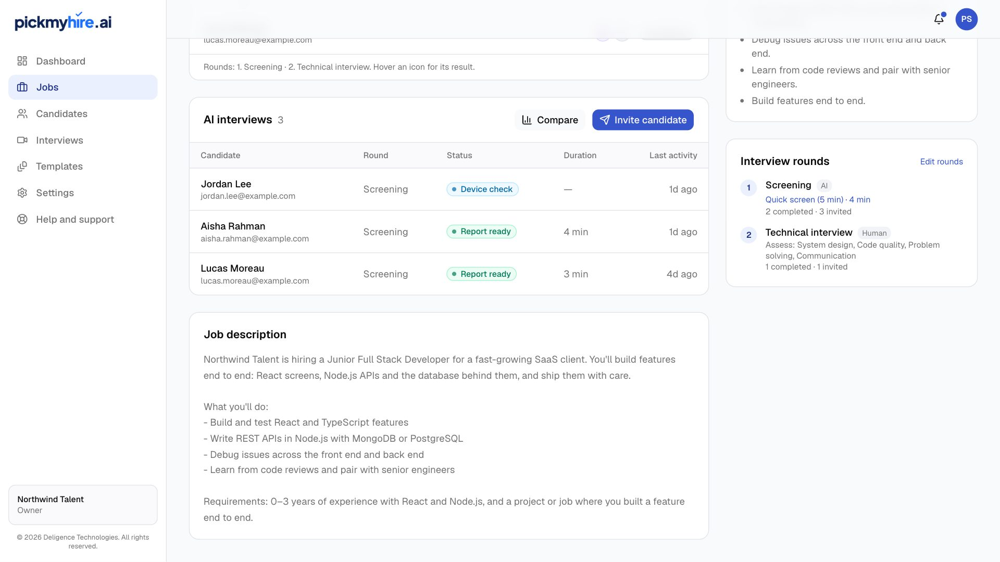

### Application questions

On the job's **Edit** page, under **Application questions**, choose what candidates answer when they apply:

- **Pay currency** and whether pay is entered as **LPA (lakhs per year)**, per year or per month;
- **Standard questions** you can switch on or off and mark **Required**: Expected CTC, Current CTC (off by default, since asking about current pay isn't allowed in some places), Notice period, Earliest joining date, Current location, Open to relocation, Preferred work mode;
- **Your own questions**, up to 20, in seven answer formats: short answer, long answer, number, date, yes/no, single choice and multiple choice. For yes/no and single-choice questions you can set an **expected answer**.

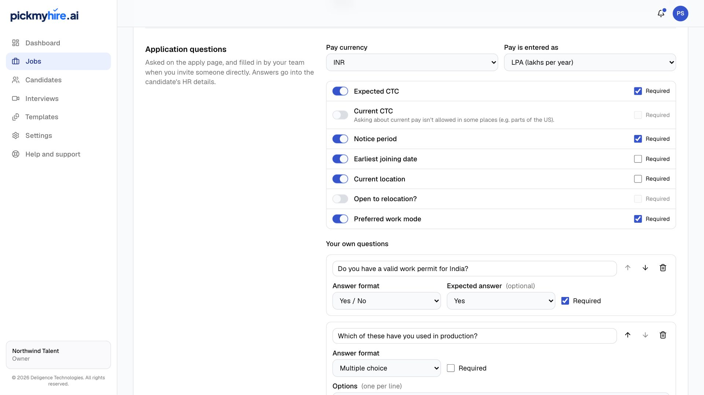

### Hiring limits and identity check

Further down the same page:

- **Hiring limits** are internal and never shown to candidates: budget range, maximum notice period, latest joining date, work mode and whether relocation is required. Every application is compared with them automatically.
- **Identity check**: switch on **Face verification** to confirm the same person attends the whole AI interview (see [section 9](#identity-check)).

Choose **Save changes** when you're done.

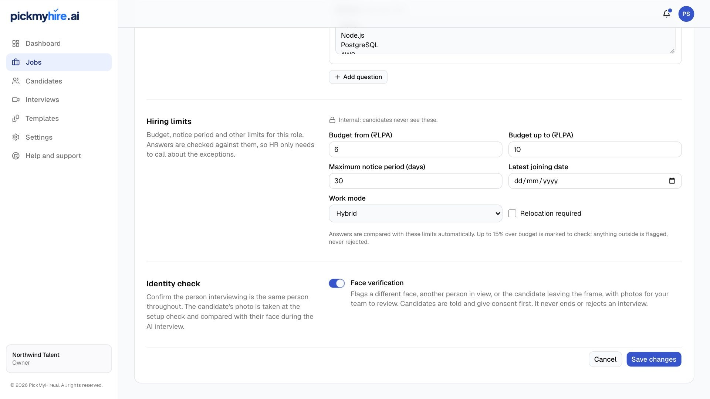

---

## 6. Receive applications

### The public apply page

Switch on **Public application link** on the job page and share the link on LinkedIn, job boards or your careers page. Candidates see the job, your branding and a short form: name, email, phone, LinkedIn, resume (PDF, DOCX or TXT), and your application questions.

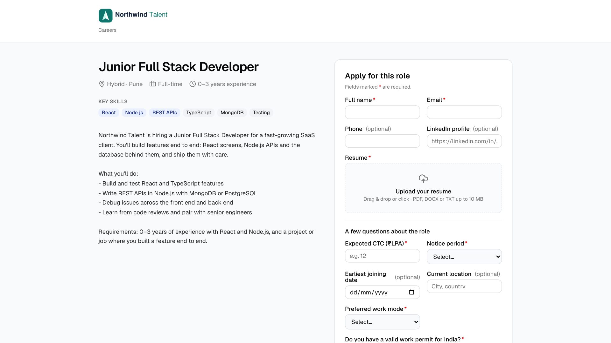

Required questions are marked, and each question uses the right input for its format: number boxes for pay, a list for notice period, date pickers, checkboxes for multiple choice. Candidates agree to AI screening before they submit.

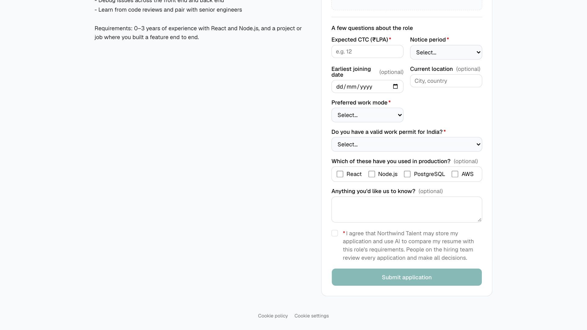

### The applications list

Every application appears on the job page within moments:

- **AI screening**: a match tag (Strong, Good, Partial, Low, Not enough info) and how many requirements the resume shows evidence for. Tags help you prioritize; they never reject anyone.
- **Fit**: how the answers compare with your hiring limits: **Fits limits**, **Check limits** (slightly outside, for example up to 15% over budget), or **Outside limits**. Hover to see why.
- **Filters**: one-click **Matches skills and limits**, match level, fit, status, and sorting by date or AI match.

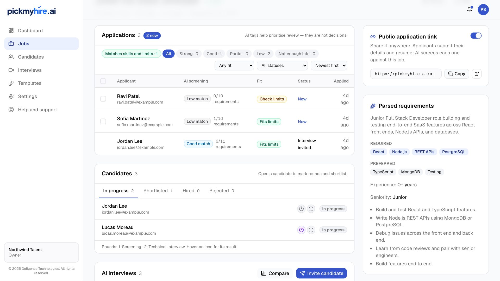

### An application

Open an application to see:

- **Answers and fit**: every answer, with a tick or warning for each limit (budget, notice period, work mode, expected answers). Choose **Edit answers** to correct them after a call;
- **AI screening**: a short summary and each requirement as **Met**, **Partially met** or **Not evident in resume**, with the quote from the resume;
- the **applicant's** details and resume;
- **HR details and notes** (see [section 11](#hr-details-and-notes)).

From here, choose **Invite to AI interview** or **Not moving forward**.

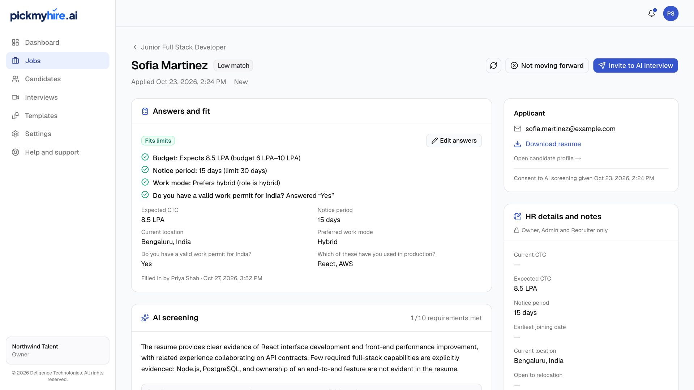

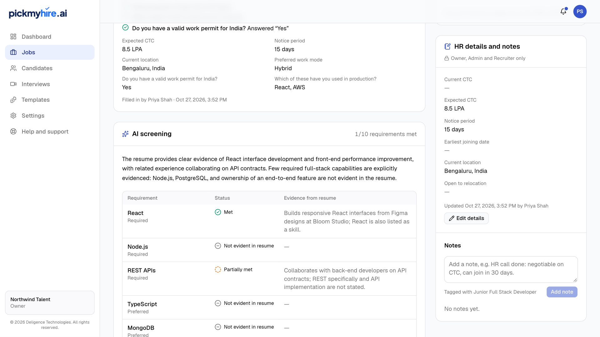

---

## 7. Invite candidates to an AI interview

### Bulk invite

In the applications list, tick the applicants you want (or the box at the top to select all new ones shown), then choose **Invite selected to AI interview**. Each candidate gets a personal link for the job's next AI round. Untick **Email the invitations now** if you'd rather send the links yourself.

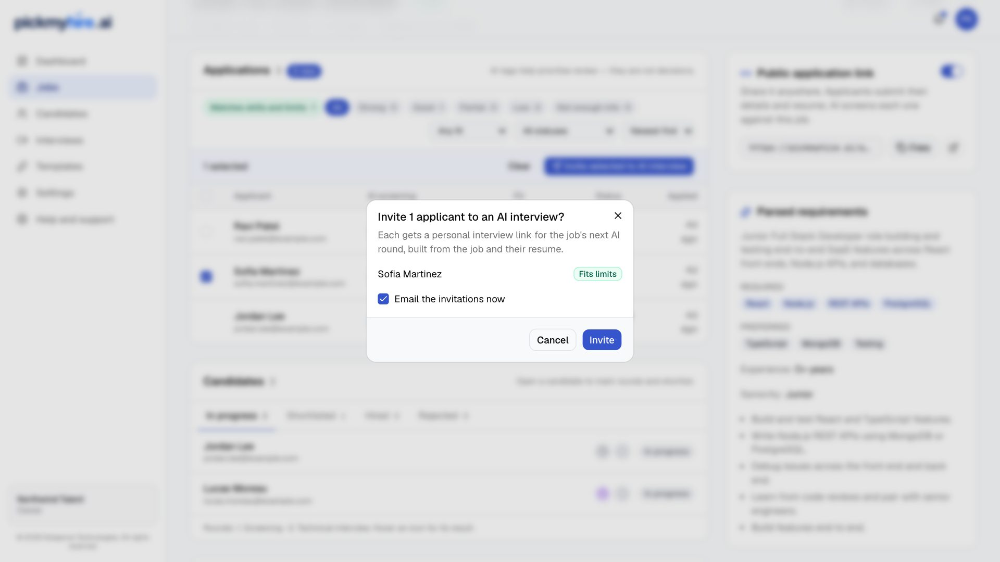

### Invite someone directly

To interview someone who didn't apply through the link, choose **Invite candidate** on the job page. Add a **new candidate** (name, email, optional phone and resume) or pick an **existing candidate**. If the job has application questions, fill in **Candidate's answers** from your call or their email, so the fit check works the same way.

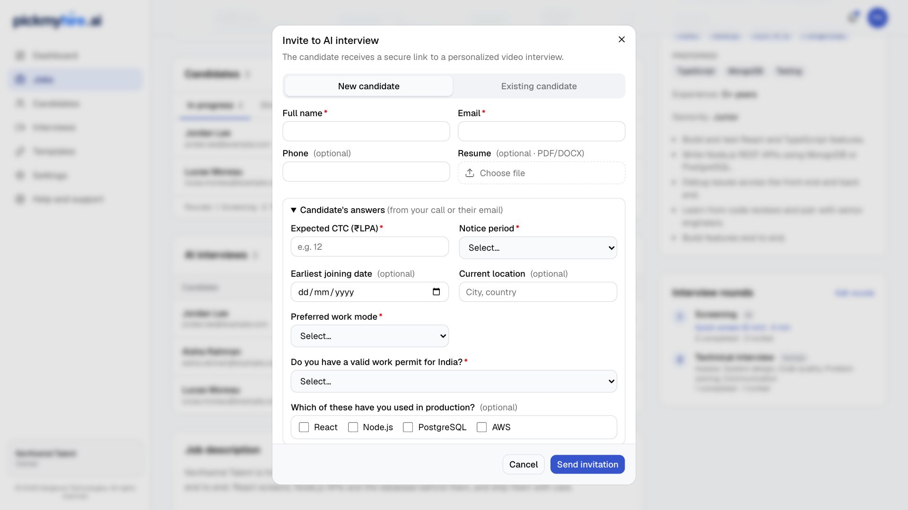

### The invitation email

Candidates get a branded email with the round, the approximate duration, what they'll need and the link's expiry date. The link is personal and works until it expires.

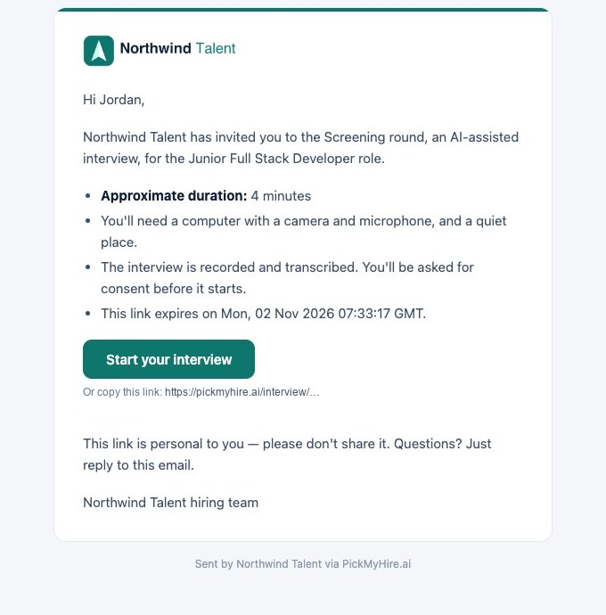

---

## 8. What the candidate sees

The candidate opens their link and goes through four short steps: **Welcome → Consent → Device check → Interview**.

### Welcome

The interview's length and parts, what they'll need, and a reminder that people at your company review every interview. If they get disconnected, they reopen the same link and continue where they left off.

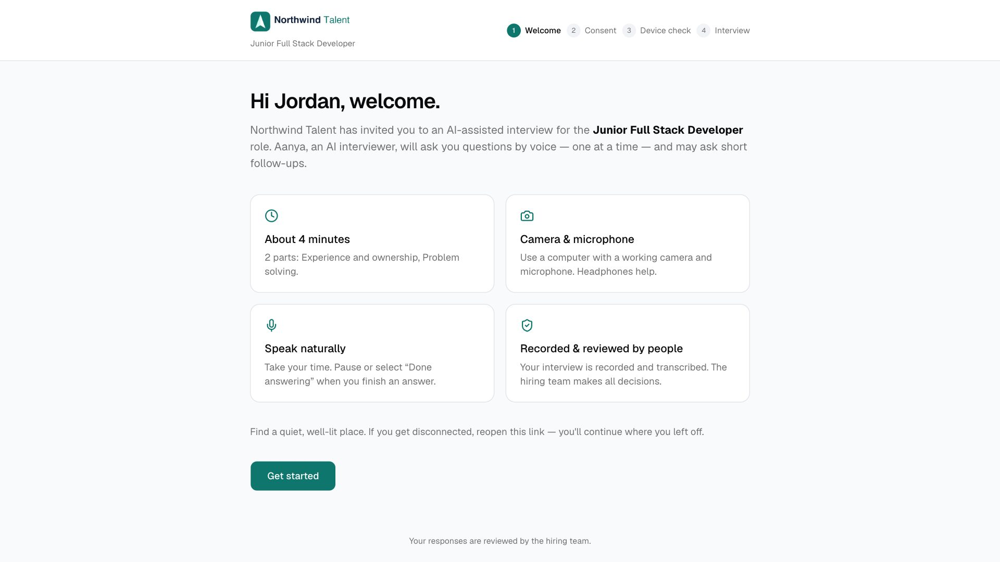

### Consent

A plain-language notice: what happens, what's recorded, how AI is used (and that it doesn't assess appearance, accent or emotion, or make decisions), the identity check if it's on, and who can see their data. The candidate must agree before anything is recorded; consent is stored with a timestamp.

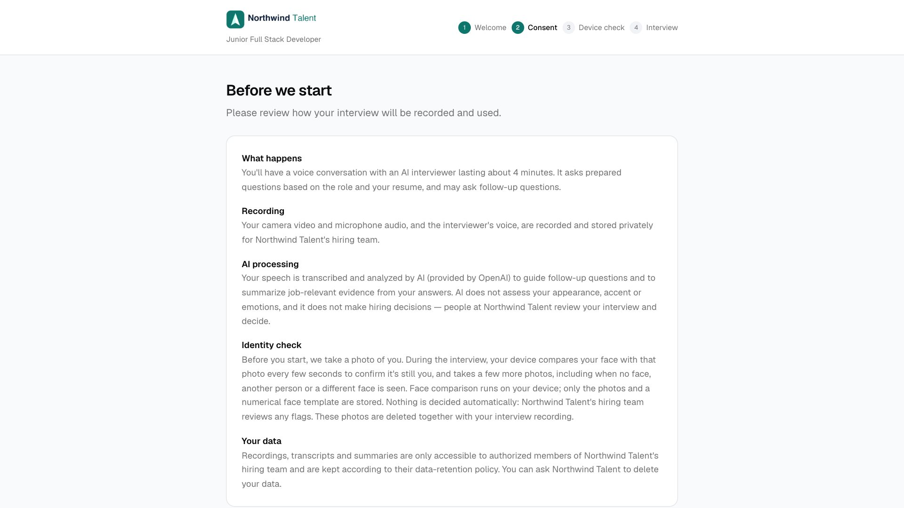

### Device check

The browser, camera, microphone, speakers, a short test recording and the connection are checked automatically. If the identity check is on, a reference photo is taken here. All checks must pass before the interview starts.

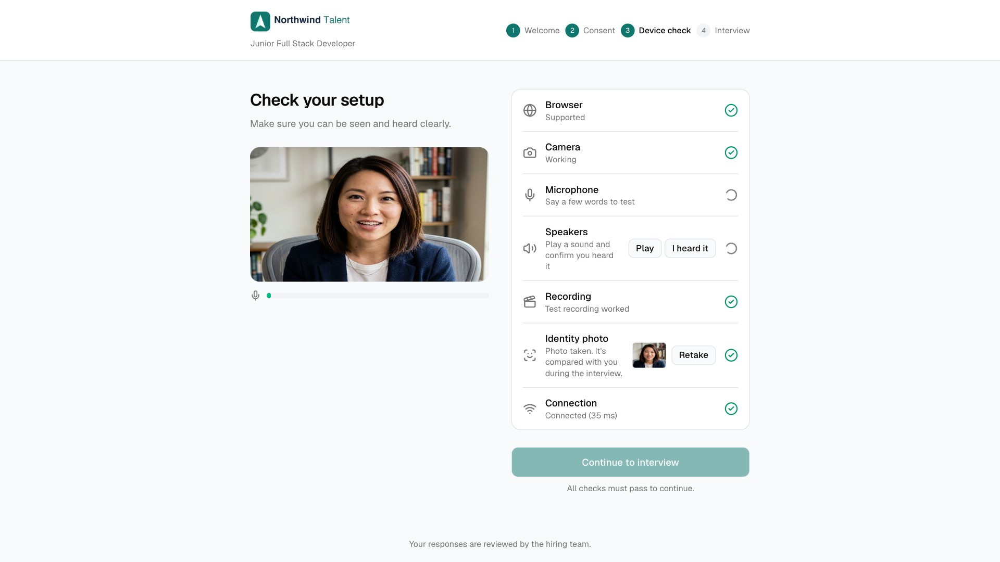

### The interview

The AI interviewer asks one question at a time by voice and may ask a follow-up when an answer leaves a real gap. The candidate sees:

- the current question, with **captions**, and a progress bar with the elapsed time;
- **Done answering** to finish an answer (it never cuts off a thinking pause);
- the option to **type** an answer instead of speaking;
- the connection and recording status; the recording uploads in the background and retries automatically.

At the end they see a confirmation screen. You get a notification, and the report is usually ready within a few minutes.

---

## 9. Review an AI interview

Open **Interviews** for every AI and human interview across your jobs, with search and filters by status and job. Status moves from **Invited** through **Opened**, **Device check** and **In progress** to **Report ready**; unused links show **Expired**.

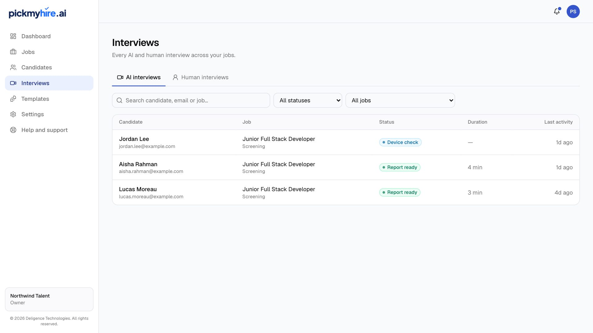

### Overview

Each interview has tabs: **Overview, Report, Transcript, Recording, Questions and Evaluation**. The overview shows the duration, sections completed, questions asked and follow-ups, the identity check, and the video with a coloured timeline of the sections and a searchable transcript beside it.

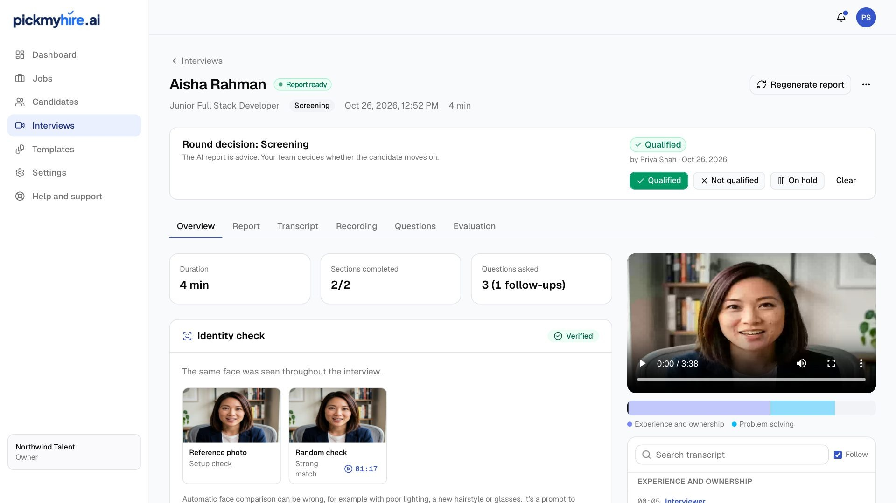

### Round decision

At the top of every interview: **Qualified**, **Not qualified** or **On hold** (and **Clear** to undo). The decision records who made it and when. The AI report is advice; your team decides whether the candidate moves on.

### Report

A summary of the candidate's interview, with the role, date and length. Implementation details and numbers the candidate mentions are marked as **candidate-reported**, not verified.

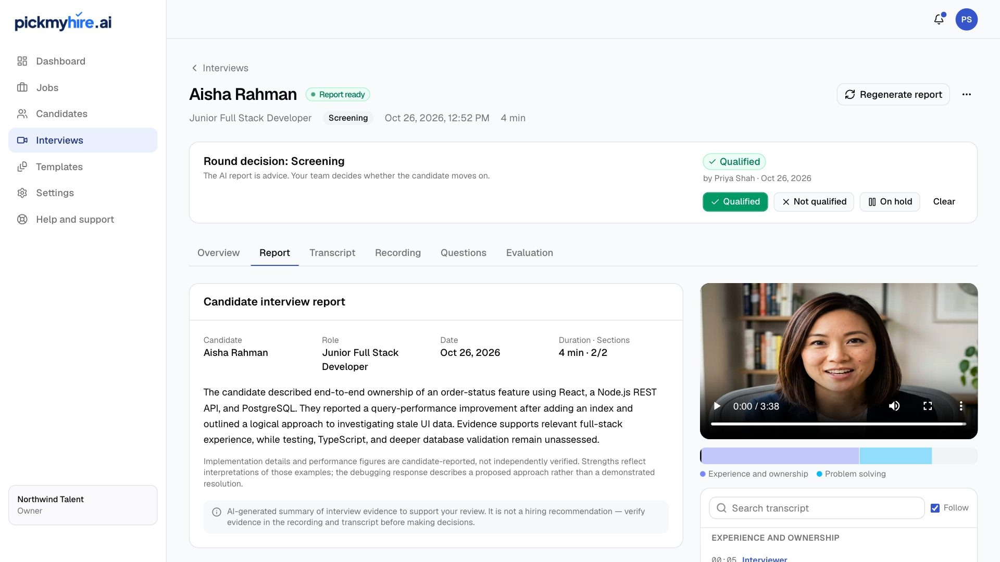

### Recording and transcript

Watch the full recording with the transcript beside it. Turn on **Follow** to keep the transcript in step with the video, or search the transcript and click any line to jump to that moment.

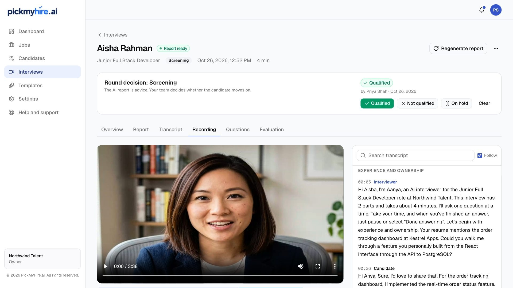

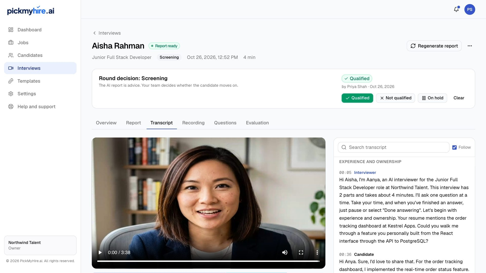

### Evaluation

Section by section: the objective, a short assessment, **strengths** and **concerns**, each linked to evidence in the interview. Click a timestamp and the video jumps to it. If section scores are on, each section shows a 1–5 score with a label (for example **Strong · 4/5**).

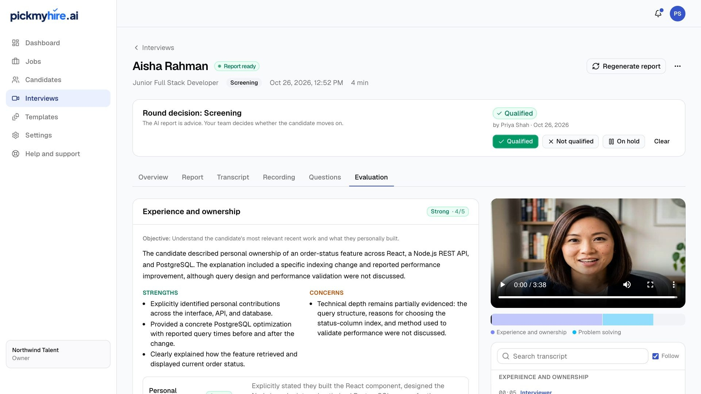

### Identity check

If face verification is on for the job, the overview shows the reference photo from the device check and photos taken during the interview, with a result such as **Verified**. A different face, a second person or nobody in view is flagged with a photo and the time, for your team to review. Face comparison runs on the candidate's device, and it never ends or rejects an interview.

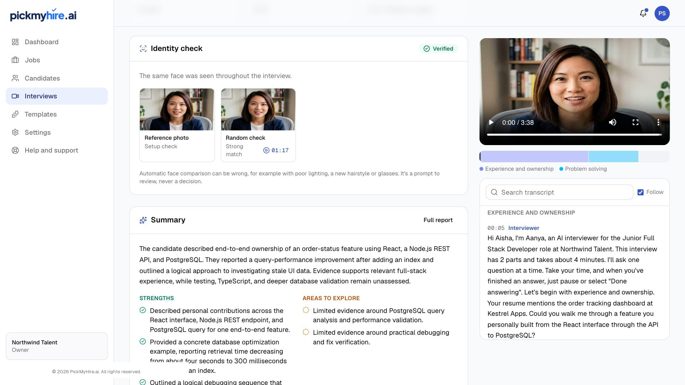

### Compare candidates

On the job page, choose **Compare** to see every candidate's section assessments side by side for each round. These are evidence summaries, not rankings; open each report before deciding.

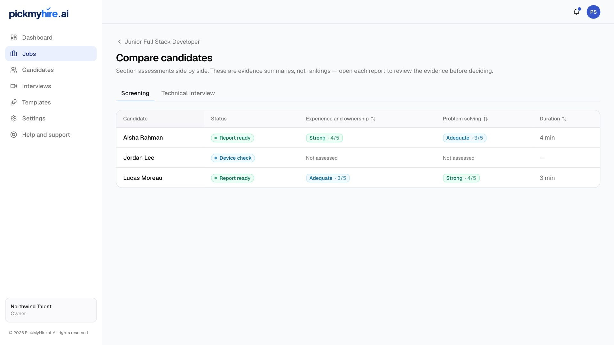

**More actions** (the ⋯ menu on an interview): **Regenerate report**, download the transcript, candidate video or interviewer voice, and delete the recording, transcript or report.

---

## 10. Human interview rounds

When a candidate is **Qualified** in a round, the next round opens. For a human round, choose **Schedule** on the candidate page (under **Hiring progress**):

- pick the **date, start time, time zone** and **duration**, and the **panel** (one or more interviewers);
- choose **Video call** (paste your Zoom, Google Meet or Teams link), **Phone call** or **In person**;
- add the **skills to rate** and an **interviewer guide**, and optionally a message to the candidate;
- PickMyHire.ai emails the candidate and the panel with calendar files, or you can **Copy invite** and download the **calendar files** yourself. Times can be changed later with **Reschedule**.

**Schedule extra interview** adds a one-off conversation without changing the job's rounds.

The human interview page shows the details, the **interview guide** (what to assess), each interviewer's **scorecard** (a 1–5 rating per skill, their recommendation and a comment) and the **Decision** for the round. Scorecards are recommendations; they lock once the round is decided.

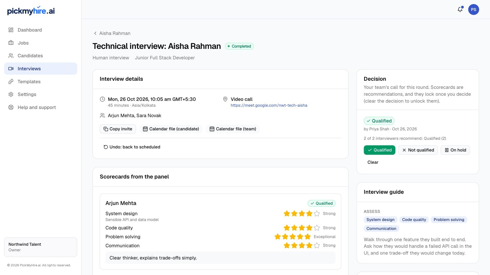

---

## 11. The candidate page and the shortlist

Open **Candidates** for everyone you've added or invited, with their top skills and latest interview. Use **Add candidate** to add someone manually with their resume.

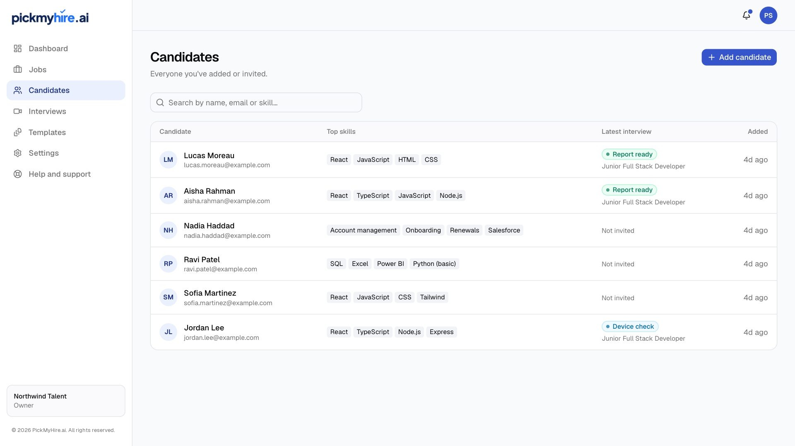

### Hiring progress

A candidate's page shows every job they're in, each round with its status and decision, and buttons to **Schedule** the next human round or **Invite to interview**. **Edit** and **Delete** are at the top. Delete removes everything about the candidate, including recordings.

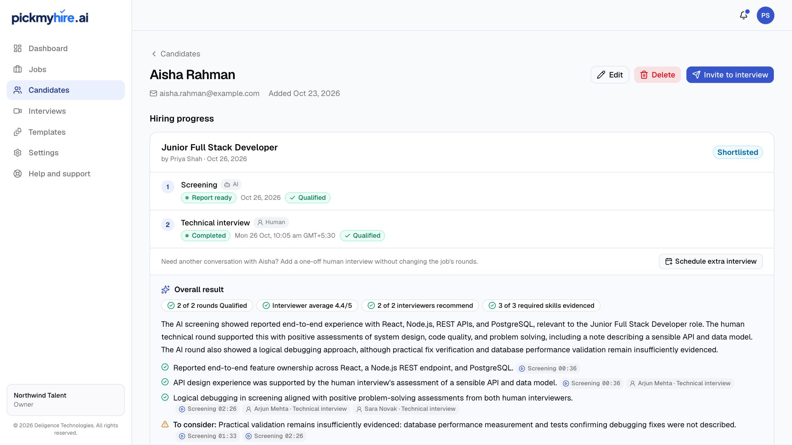

### Overall result

Once a candidate clears **every round** of a job, an **Overall result** appears automatically, to support the final decision:

- the facts: rounds qualified, the interviewers' average score, how many interviewers recommend, and how many required skills have evidence;
- a short summary across all rounds;
- the key points, each with links to the moment in the AI interview and to the interviewers' scorecards, plus anything **to consider**;
- a highlighted interviewer comment.

It doesn't recommend hiring; your team decides. Then choose **Shortlist**, **Mark as hired**, **Reject** or **Move back to in progress**.

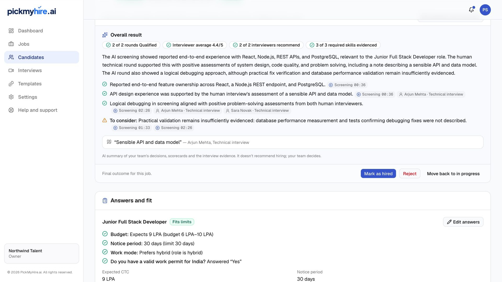

### HR details and notes

Every candidate has **HR details** (current and expected CTC, notice period, earliest joining date, location, relocation), filled in automatically from their application answers and editable with **Edit details**, plus **Notes** for anything from HR calls (for example "negotiable on CTC, can join in 30 days"). Notes are tagged with the job and the author.

HR details and notes are the same on the application page and the candidate page, so everyone sees the latest. They are visible only to Owners, Admins and Recruiters, and are never shown to the AI.

The candidate page also shows **Answers and fit** for each job, the **Extracted profile** from the resume and the **Resume** itself.

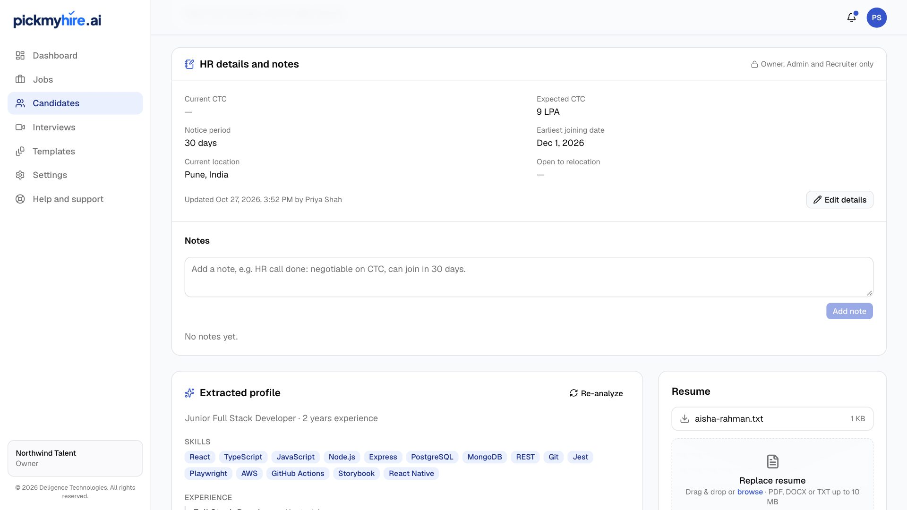

---

## 12. Help and support

Open **Help and support** to message the PickMyHire.ai team: report a problem, ask a question, request a feature, or ask about billing. Add a link to the page if it helps. Your name, email and company are included automatically. Replies appear here and by email, with your company's earlier requests listed on the right.

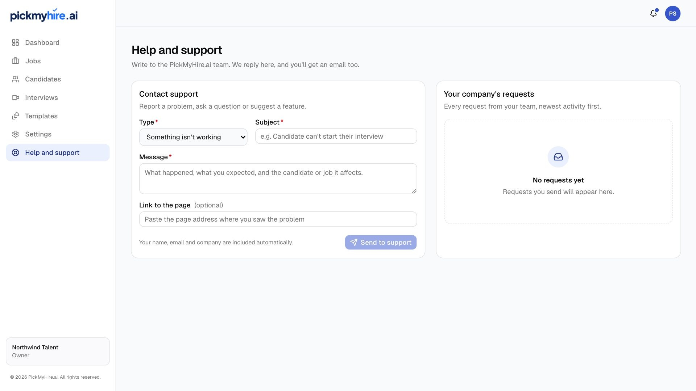

---

## 13. Good to know

- **Interview length.** An interview follows the template's timing. If a candidate takes longer, it continues up to about 1.3 times the planned length, and it never cuts a candidate off in the middle of an answer.
- **Dropped connections.** Candidates reopen the same link and carry on where they left off; nothing already recorded is lost.
- **Fairness.** Only job-relevant evidence is assessed. Nothing is inferred from age, gender, accent, appearance or emotion, and salary and HR details never reach the AI.
- **Nothing is automatic.** Match tags, fit, reports, identity flags and the overall result are there to help your team; no candidate is rejected or advanced without a person deciding.
- **Your data stays yours.** Each company's data is kept separate, files are private and open only through short-lived links, and every access is in the audit log.
- **Website analytics** run only on public pages and only with the visitor's consent; never on interview links or inside the app. See the [cookie policy](https://pickmyhire.ai/cookies).

---

## 14. Quick-start checklist

- [ ] Sign up and sign in
- [ ] **Settings → Interview**: company name and interviewer name
- [ ] **Settings → Branding**: logo and brand colour
- [ ] **Settings → Team**: invite your recruiters and interviewers
- [ ] **Settings → Privacy and data**: choose a retention period
- [ ] **Templates**: check the ready-made templates or create your own
- [ ] **Jobs → New job**: paste the job description and check the parsed skills
- [ ] **Edit rounds**: add your AI and human rounds
- [ ] **Edit → Application questions and hiring limits**: set your questions, budget and notice period
- [ ] Switch on the **public application link** and share it
- [ ] Invite the best-fitting applicants to the AI interview
- [ ] Review reports, decide each round, schedule human rounds
- [ ] Use the **Overall result** to shortlist and hire

---

## Appendix: Platform admin

*For the PickMyHire.ai team only.* Platform admins see **Platform admin** under the logo and manage every company on the platform.

### Overview

The number of companies, users, completed interviews and new inquiries, plus free trials, companies out of free interviews, the newest companies and recent candidate issue reports.

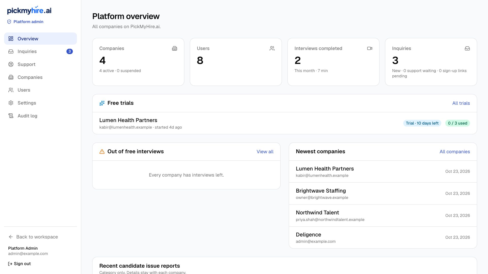

### Companies

Every company with its status, free interviews used, members and last interview. Filter by **Active, Free trials, Suspended** or **Out of interviews**, or create a company with **New company**.

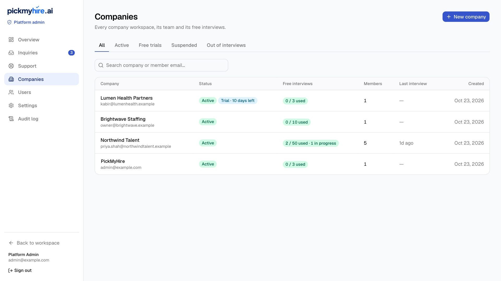

Open a company to:

- manage its **members** and roles, including transferring ownership;
- set its **allowed free interviews** (or unlimited) and keep **private notes**;
- **Suspend** it, and once suspended, **Delete company**. Deletion shows exactly what will be removed (jobs, candidates, interviews, recordings and files) and can also delete members' accounts so their emails can be used again. You confirm by typing the company name.

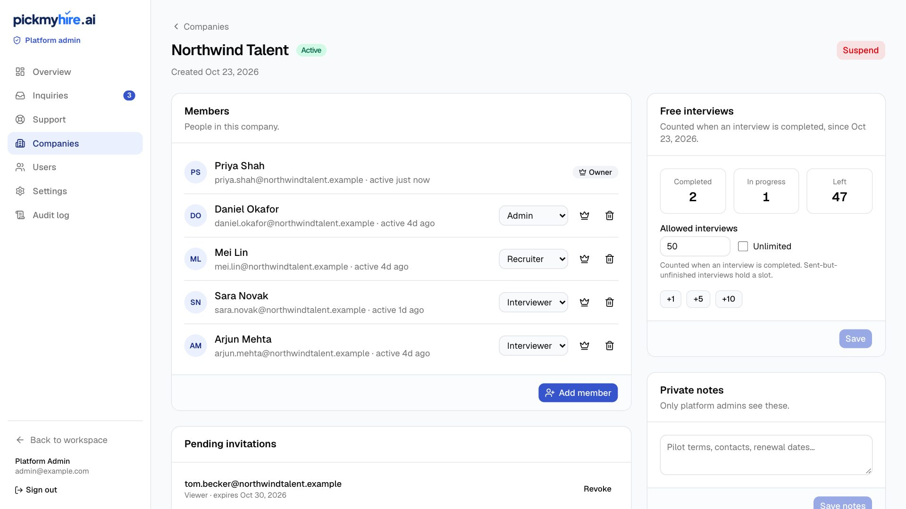

### Users

Everyone with an account. From the ⋯ menu on a user:

- **Change email** fixes a mistyped email. Their account and history stay the same.
- **Delete user** removes the account so the email can sign up again. It shows first which companies they'd be removed from, and any company where they're the only member is deleted too. You confirm by typing their email. Someone who already used a free trial can't start another one with the same email.

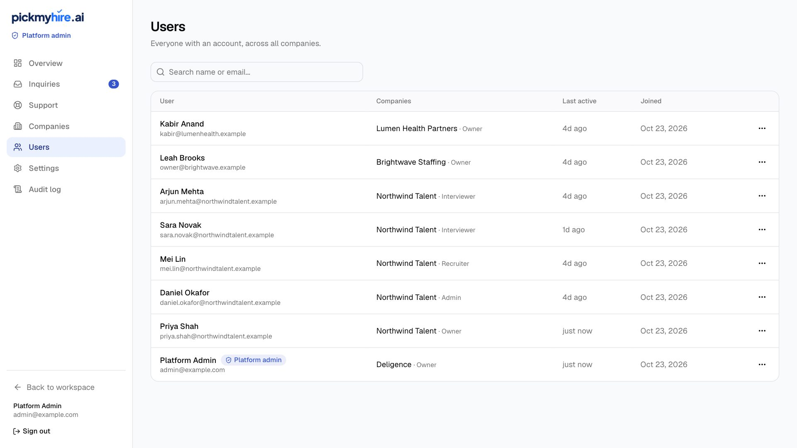

### Coupons

Promo codes for campaigns. Choose **New coupon** and set:

- the **code** (type one or generate it), the **free interviews** it adds and the **extra trial days** it gives (trial days apply only to companies on a free trial, and restart an ended trial);
- optionally the **maximum number of companies**, a **valid until** date and a **campaign note**;
- **On / Off** to stop a code at any time.

Each company can use a code once, and so can each person, even from a new company. Wrong, switched-off, expired and used-up codes all get the same message. Open a coupon to see which companies used it, who applied it and what they received. Unused coupons can be deleted; used ones are switched off instead, so their history is kept.

### Inquiries, support and settings

- **Inquiries**: requests from the website (access requests, demos, pricing, partnerships). Add private notes, **Mark contacted**, and approve an access request to send a one-time sign-up link.
- **Support**: requests customers send from Help and support. Replies reach them in the app and by email.
- **Settings**: switch the **free trial** on or off and set the interviews and days per trial, require email confirmation, manage the **shared access code**, and set defaults for new companies.
- **Audit log**: every platform admin action.

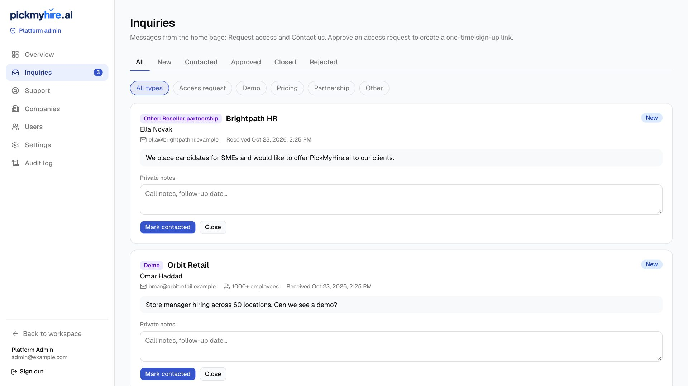

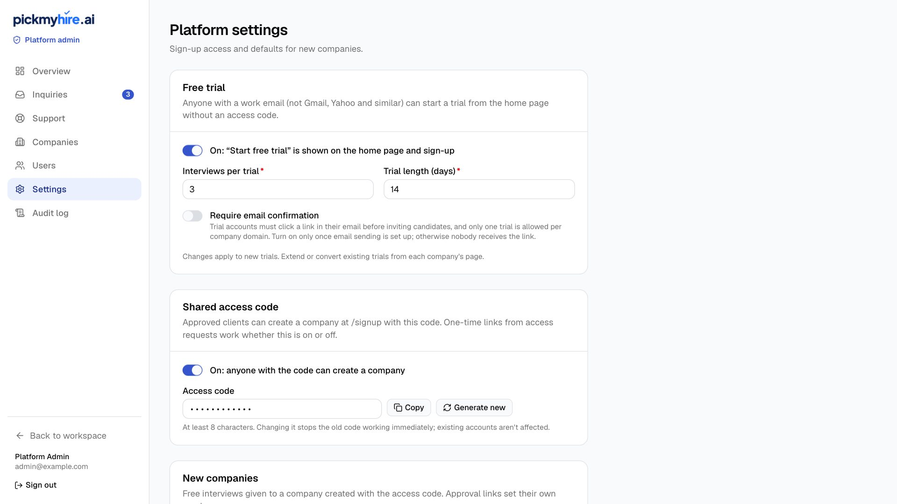

---

<p align="center">
  <strong>PickMyHire.ai</strong> is built and owned by <a href="https://deligence.com"><strong>Deligence Technologies</strong></a>.<br>
  © 2026 Deligence Technologies. All rights reserved.
</p>
